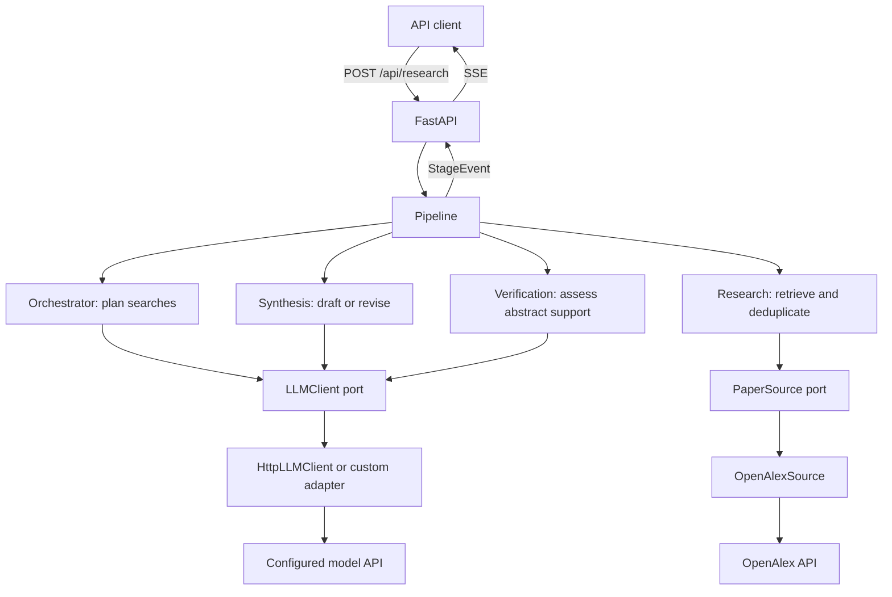

# PaperTrace AI — Project Context

This file is the single source of truth for *what* PaperTrace AI is and *why* it is built the way it is.
`PLAN.md` says *when* each part gets built. `CLAUDE.md` / `AGENTS.md` say *how* to work in the repo.

## 1. Product

PaperTrace AI is a scientific research assistant. A user asks a question in natural language
(Portuguese or English). The system:

1. plans the search,
2. queries a real academic source,
3. writes a synthesis citing only retrieved papers, streamed as a draft,
4. checks abstract support, optionally revises once and verifies again,
5. returns the evidence-assessment report, and a revised synthesis when a revision is accepted.

The system must never invent papers, authors, DOIs or findings that the retrieved sources do not support.
When the evidence is thin, it says so instead of filling the gap.

Application UI, prompts, logs and documentation are in English. User questions may be in PT or EN;
the synthesis and model-generated verification reasons follow the question language. Deterministic
insufficient-evidence and technical error messages currently remain in English.

## 2. Developer and purpose

- Author: Guilherme Abreu Cavazzani — Electrical Engineering student (UFSJ), Data Analysis intern in the
  CI&T NextGen AI program, Claude Certified Architect – Foundations (CCAF).
- GitHub: https://github.com/Gu1L3RM3
- Independent public portfolio project aimed at AI Engineering roles.
- **No employer code or data may be used.**
- Local project only: no deploy, no production infrastructure.

## 3. v1 scope

Four agents, one data source, no persistence, no cross-database verification. Abstract-only verification was explicitly approved.
Anything beyond this is v2 and needs explicit approval before being added.

| Agent | Input | Output | Notes |
|---|---|---|---|
| **Orchestrator** | `ResearchQuestion` | `SearchPlan` (2–4 `SearchQuery`) | Forced tool call (structured output). Queries are always in English and each covers a different angle. |
| **Research Agent** | `SearchPlan` | `ResearchResult` (papers + failed queries) | Runs all queries against OpenAlex concurrently with `asyncio.gather` over real I/O. Deduplicates by DOI (normalized title when DOI is missing). |
| **Verification Agent** | Question + synthesis + retrieved papers | Structured claim/evidence report | Reports abstract support; the pipeline decides whether to revise once and re-verify. |
| **Synthesis Agent** | `list[Paper]` + question | `SynthesisResult` (Markdown) | Sees only the structured paper list, never free web text. Cites as (Author, Year). Must state when evidence is insufficient. |

Contracts between agents are Pydantic models, never loose dicts.

### Current contracts

- `ResearchQuestion`: nonempty trimmed question text.
- `SearchPlan`: 2–4 English queries, each with a search angle.
- `Paper`: title, authors, year, normalized DOI, optional abstract and URL.
- `ResearchResult`: deduplicated `papers` and `failed_queries`.
- `SynthesisResult`: `markdown`, `unmatched_citations`, `insufficient_evidence`.
- `VerificationResult`: assessed `claims`, `findings`, computed `status`, `reason`,
  `revision_count` (0 or 1). Evidence identifies a one-based paper index and an abstract quote.

There is no separate `Citation` model or `citations` array in the current synthesis contract.
The verifier checks claim spans, paper indices and abstract quotes deterministically; semantic
support and completeness of claim extraction still depend on the model.

## 4. Architecture

### Ownership and dependencies



`Pipeline` is the coordinator. The Orchestrator is a search planner, not a supervisor of other
agents. Agents return typed results to the pipeline; they do not call each other. In particular,
the verifier never invokes synthesis directly. `api/dependencies.py` builds adapters, agents and
the pipeline at application startup, using settings loaded by `pydantic-settings`.

The pipeline depends on small stage protocols (`Planner`, `Researcher`, `Synthesizer`, `Verifier`).
Agents depend on `LLMClient` or `PaperSource`, not provider implementations. Pure domain functions
handle deduplication, citation matching, abstract rebuilding and verification-report validation.
The API serializes results; it does not interpret scientific claims.

### Execution and one bounded revision

1. FastAPI validates the question and invokes the shared pipeline for this request.
2. Orchestrator submits a forced tool call producing a validated `SearchPlan`; emit `plan`.
3. Research executes the plan's queries concurrently, deduplicates their papers and records
   partial failures; emit `papers`.
4. Synthesis writes a draft from the question and retrieved papers. The citation checker records
   unknown author/year references. Emit `synthesis` (the draft) at once.
5. Verification uses a forced tool call to assess claims and return evidence. Domain validation
   flags invented spans, indices and quotes and computes the report status; emit `verification`.
   A report that fails validation degrades to `not_verifiable` instead of failing the run.
6. If the report `needs_revision` (a non-supported claim, counterevidence, a non-ambiguity
   finding or unmatched citations), run one synthesis revision using the question, papers,
   draft and report. The citation checker runs again; a revision with more unmatched citations
   than the draft is discarded. Otherwise the verifier assesses the whole revised text.
7. An accepted revision is emitted as a second `synthesis` (`revision: true`) followed by its
   `verification` (`revision_count` 1); the client replaces the draft. Then `done`. If the
   revision or its re-verification fails, the draft stays and the run still ends with `done`.

The stages within one request are sequential. Only OpenAlex queries within Research run in
parallel. Separate requests can overlap; the LLM semaphore is shared across the pipeline's
agents and requests within one application instance, not across separate server processes.
A normal evidenced run uses three logical LLM calls; a revised run uses five, excluding retries.
The retrieval CLI runs only planning and research, not the synthesis/verification pipeline.

### Streaming and failures

Success events: `plan` → `papers` → `synthesis` → `verification` → `done`, plus a second
`synthesis` → `verification` pair when a revision is accepted.
Each event contains a serialized model; `done` has `{}`. LLM text is not streamed token by token.
The draft synthesis streams as soon as it exists; only the revised pair waits for the extra calls.

| Condition | Behavior visible to the client |
|---|---|
| Missing/blank question or invalid request body | HTTP 422 before a pipeline stream starts. |
| Settings/provider construction fails at startup | App startup fails; no SSE `error` is produced. |
| Planner fails, omits the forced tool call or returns invalid arguments | `error`; no later stages or `done`. |
| Some OpenAlex queries fail but others return papers | Continue; `papers.failed_queries` lists failed queries. |
| All OpenAlex queries fail | `plan` then `error`; no `papers`. |
| Some queries fail and successful queries return no papers | Emit `papers` then `error`; do not present this as a complete empty search. |
| Search succeeds but returns no papers, or no usable abstracts | Deterministic insufficient-evidence synthesis and `not_verifiable` report, then `done`; no synthesis/verifier LLM calls or revision. |
| Initial synthesis or the first verification call fails | Earlier events may exist (the draft `synthesis` if it was produced); then `error`, without `done`. |
| Revision or its re-verification fails | Logged; the draft and its report stand, then `done`. |
| Report references missing claim text, unknown paper indices or absent abstract quotes | Report rejected: `not_verifiable` ("Verifier output failed validation"); fabricated provenance is never accepted. |
| Claims are partial, contradicted or unsupported; counterevidence/findings/ambiguous or unknown citations exist | Revise once and re-verify (ambiguity alone does not trigger a revision). Remaining problems stay visible in the report. |
| Empty claim assessments with usable abstracts | `not_verifiable`, one revision/re-verification; still never treated as approval if empty afterward. |
| Unexpected exception inside the pipeline | Log the exception and emit a generic `Unexpected internal error`; no `done`. |

Known `PaperTraceError` exceptions are exposed through `error.message`. Unexpected exception
details are withheld from the client. Once SSE has started, clients must inspect event names:
HTTP success alone does not mean the research succeeded. `done` means processing finished,
not that every scientific claim is correct.

The built-in LLM adapter attempts each HTTP call up to three times on transport failures or
HTTP 429, 500, 502, 503 and 504, waiting 1 then 2 seconds with the semaphore released.
Other HTTP failures (for example 401/403), invalid JSON/response shape, invalid tool output and
invalid verification provenance are not automatically retried. The LLM client's configured
httpx timeout is 120 seconds; OpenAlex's shared HTTP client uses 30 seconds. These are HTTP
client timeouts, not a total research deadline. OpenAlex has no explicit retry loop.
Ordinary malformed paper records are skipped by its adapter; unexpected errors still propagate.

`insufficient_evidence` is currently an availability flag: true when no usable abstracts exist.
It is not recalculated from semantic findings, and revision preserves its previous value.
With abstracts available, inspect `verification` and `unmatched_citations` even when that flag
is false. The verifier cannot prove truth or independently inspect full text.

### Source layout and implementation status

```text
src/papertrace/
  domain/      Models and pure validation/dedup/citation/abstract functions; no I/O.
  llm/         LLMClient port, HTTP adapter and provider factory.
  sources/     PaperSource port and OpenAlex adapter.
  agents/      Orchestrator, Research, Synthesis and Verification.
  pipeline.py  Stage protocols, coordination and typed StageEvents.
  api/         FastAPI routes, SSE and dependency wiring.
tests/
  unit/        Domain and agents with fakes.
  contract/    Shared adapter contract tests.
  integration/ API/SSE tests; real API tests are opt-in.
```

The backend and retrieval CLI exist. The vanilla JS frontend (`web/static/`) and the `papertrace`
server command remain Stage 3 work; the current server command is `uv run uvicorn papertrace.api.app:app`.

## 5. LLM provider independence

The project must run on any LLM that supports tool calling, and switching provider must be a `.env` change.

- `LLMClient` is a small async protocol:
  - `call_tool(system, messages, tool: ToolSpec[T]) -> T` — forced tool call, output validated into a Pydantic model.
  - `complete(system, messages) -> str` — free text.
- `HttpLLMClient` is the built-in adapter: plain `httpx` against any chat/completions endpoint
  with function calling (Ollama, vLLM, LM Studio, OpenRouter, Groq, gateways, hosted APIs).
  No vendor SDK is a dependency. APIs with another protocol plug in as a new `LLMClient`
  class, registered by name or loaded from `LLM_PROVIDER=package.module:function`.
- `build_llm_client(settings)` picks the adapter from `LLM_PROVIDER`.
- Each agent can use a different model (`ORCHESTRATOR_MODEL`, `SYNTHESIS_MODEL` override `LLM_MODEL`;
  `VERIFICATION_MODEL` falls back to the effective synthesis model).
- All adapters pass the same contract test suite (Liskov substitution, proven by tests).
- Calls use async I/O. `LLM_MAX_CONCURRENCY` (an `asyncio.Semaphore`) caps concurrent LLM
  requests within one application instance; it does not make dependent stages parallel.

### Environment variables (generic names on purpose)

| Variable | Example | Purpose |
|---|---|---|
| `LLM_PROVIDER` | `chat_completions` (default) / `pkg.mod:fn` | Selects the adapter |
| `LLM_API_KEY` | — | Optional bearer key |
| `LLM_MODEL` | the name your server expects | Default model for all agents (required) |
| `LLM_BASE_URL` | `http://localhost:11434/v1` | Chat/completions endpoint (required) |
| `ORCHESTRATOR_MODEL`, `SYNTHESIS_MODEL`, `VERIFICATION_MODEL` | — | Optional per-agent overrides |
| `LLM_MAX_CONCURRENCY` | `4` | Parallel LLM calls cap |
| `OPENALEX_MAILTO` | `you@example.com` | OpenAlex polite pool |

## 6. Engineering principles

### SOLID (explicit, enforced in review)

- **S** — one class, one reason to change: each agent does one job; the pipeline only coordinates;
  adapters only translate between vendor APIs and domain models.
- **O** — new LLM providers or paper sources are new classes implementing a port. Agents and the
  pipeline are not edited to add them.
- **L** — every implementation of a port passes the same contract tests; fakes used in tests are
  real substitutes, not mocks of internals.
- **I** — ports are small: `PaperSource.search(query, limit)`, `LLMClient.call_tool/complete`.
- **D** — agents receive ports through the constructor. Concrete classes are wired only in
  `api/dependencies.py` (the composition root).

### TDD

Red → green → refactor for every behavior. Tests never touch the network in CI: HTTP is mocked with
`respx`, LLMs are replaced by fakes implementing `LLMClient`. Live tests exist but are opt-in.
Fixtures are recorded from real OpenAlex responses; no invented papers even in tests.

### Git

Atomic commits, Conventional Commits, short subject (≤72 chars). Work happens on a branch per stage,
merged through a PR with green CI. `main` is protected.

## 7. Stack

Python 3.12, uv, FastAPI, Uvicorn, httpx (async), Pydantic v2, pydantic-settings, sse-starlette,
no LLM vendor SDK. Tests: pytest, pytest-asyncio, pytest-cov, respx. Quality: ruff, mypy, pre-commit.
Planned frontend: vanilla HTML/CSS/JS served by FastAPI, no framework or build step.

## 8. Frontend direction

A distinctive visual identity drawn from the domain: academic research, citations, traceability.
Think library catalog cards, footnotes, citation trails, the margin notes of a paper. Avoid generic SaaS
looks: no identical rounded cards, no decorative gradients, no cream+terracotta "AI" palette.
The planned UI shows plan, papers, draft synthesis and verification as SSE events arrive, and replaces the draft when a `revision: true` synthesis arrives.
Every citation in the synthesis links to the paper it came from. The `frontend-design` skill is used
before any CSS is written.

## 9. Constraints (v1)

- OpenAlex is the only data source.
- Abstract-only verification is approved; no full-text or cross-source verification.
- No persistence, no auth, no deploy.
- Do not expand scope without asking.

## 10. Known v1 limitations

- OpenAlex abstracts are partial or missing for some papers; synthesis works from abstracts only.
- Citation post-check matches (Author, Year) pairs, not the content of claims.
- No caching: each question costs fresh LLM and OpenAlex calls.

## 11. v2 roadmap

- Additional sources: arXiv, Crossref; cross-source deduplication and verification.
- Extend verification to full text; abstract-only checking is implemented.
- Persistence of research sessions and exports (BibTeX, Markdown).

## 12. Glossary

- **Port** — a protocol the core depends on (`LLMClient`, `PaperSource`).
- **Adapter** — a concrete implementation of a port for one vendor.
- **Composition root** — the one place where adapters are instantiated and injected.
- **Grounded** — every claim and citation traces back to a retrieved paper.

### Approved verification extension

The draft is streamed and may be replaced once by a revision. The verifier uses forced tool calling through `LLMClient`, with literal
claim spans and abstract quotes validated in `domain/`. Non-supported claims, findings, empty
assessments or unmatched citations trigger one revision and full re-verification. Remaining issues stay visible. A failed first
synthesis or verification ends with `error` and no `done`; a failed revision keeps the draft.
Missing usable abstracts skip synthesis/verification LLM calls. Empty assessments never pass.
`VERIFICATION_MODEL` defaults to the effective synthesis model and shares the concurrency cap.
This is not proof of claim truth: the LLM may omit claims or misjudge support, and abstracts are
incomplete. Bibliographic identity still uses author/year, with ambiguity reported explicitly.
